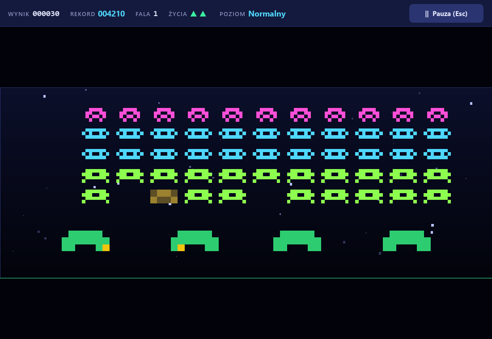
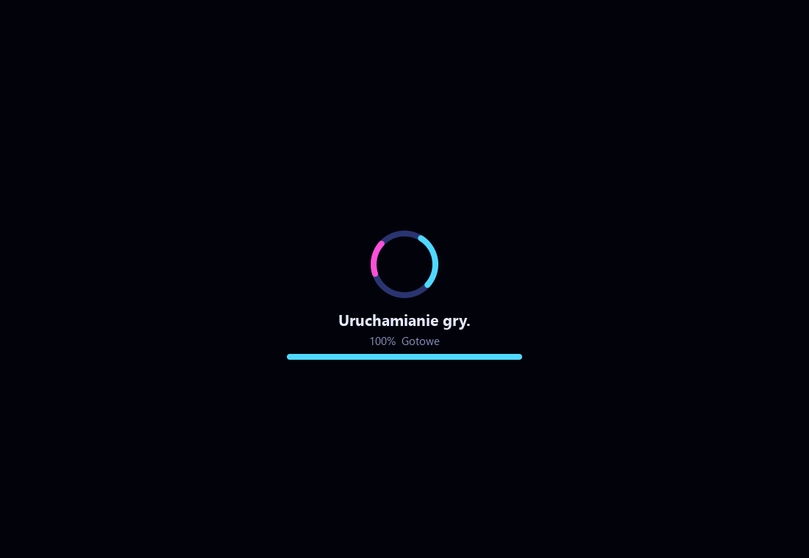
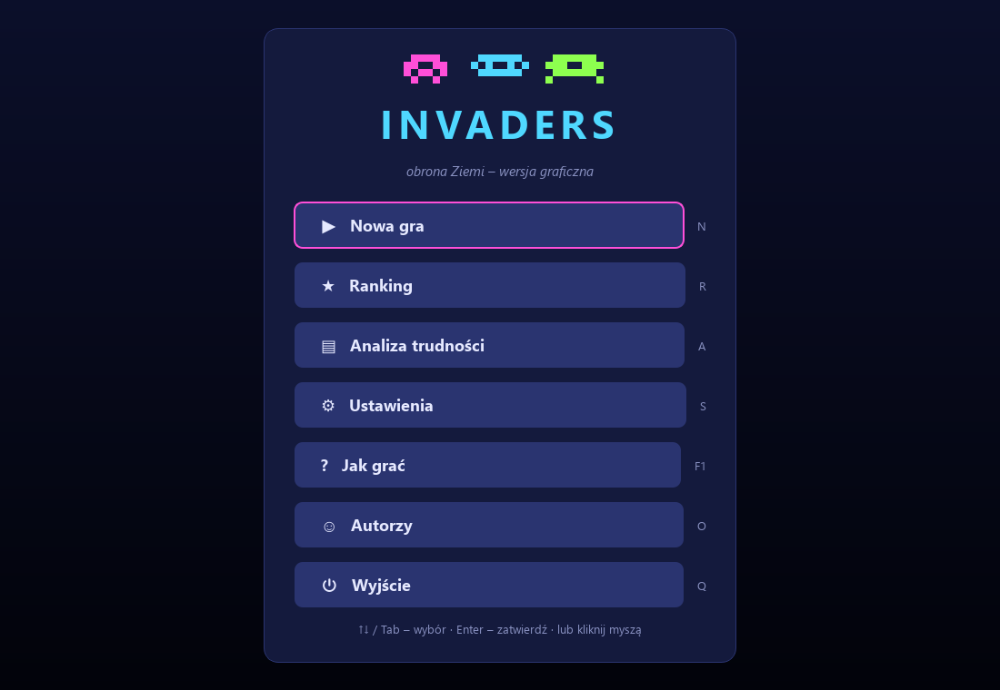
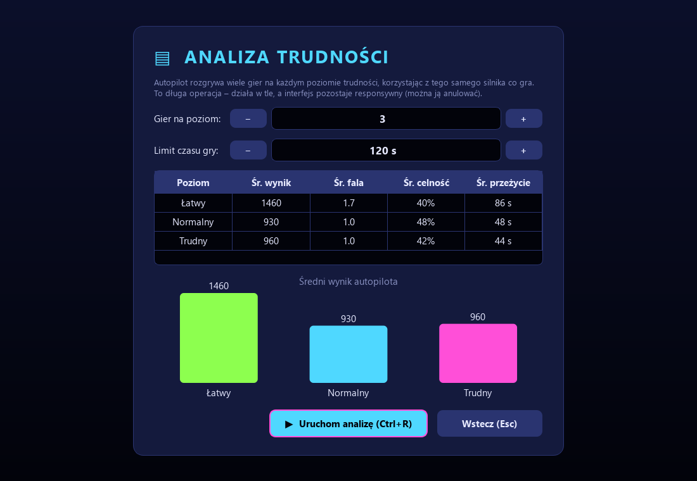

# Invaders GUI – graficzna wersja gry (Qt / PySide6)

Okienkowa wersja konsolowej gry [Invaders](../invaders). Cała logika gry pochodzi
z pakietu **`invaders.core` projektu konsolowego, dołączonego jako zależność bez żadnych
zmian**. Ten projekt to wyłącznie nowa warstwa interfejsu.



| Ładowanie | Menu | Analiza (długa operacja) |
|-----------|------|--------------------------|
|  |  |  |

## Instalacja i uruchomienie

```bash
cd invaders-gui
uv sync                          # PySide6 + invaders (ścieżka ../invaders, edytowalnie)
uv run python -m invaders_gui    # start aplikacji
uv run python -m pytest          # testy (pytest-qt, tryb offscreen)
uv run ruff check .
```

Wymaga katalogu `../invaders` obok (projekt konsolowy).

## Ekrany

Ładowanie (start i każda długa operacja) · Menu główne · Nowa gra · Rozgrywka z HUD
i nakładką pauzy · Koniec gry z wyborem inicjałów · Ranking · Analiza trudności ·
Ustawienia · Jak grać · Autorzy.

## Sterowanie

| Akcja | Klawiatura | Mysz |
|-------|------------|------|
| ruch | ← → / A D | ruch kursora nad planszą |
| strzał | Spacja / ↑ / W (przytrzymanie = seria) | lewy przycisk |
| pauza | Esc / P | prawy przycisk lub przycisk „Pauza” |
| menu | ↑↓ / Tab, Enter, Esc, skróty (N, R, A, S, F1, O, Q) | klikanie |
| pełny ekran / wyjście | F11 / Ctrl+Q | Ustawienia / „Wyjście” |
| inicjały | ↑↓ litera, ←→ pozycja, można też pisać, Enter | przyciski ▲ ▼ |

## Jak spełnione są wymagania

| # | Wymaganie (pkt) | Realizacja | Gdzie |
|---|-----------------|------------|-------|
| 1 | Logika z aplikacji konsolowej bez zmian (20) | Zależność `invaders` przez `[tool.uv.sources] path = "../invaders"`. GUI używa tylko publicznego API: `GameEngine.step(dt, commands)`, `engine.state`, zdarzeń, `HighScoreStore`, `read_json`/`write_json_atomic` i nawet danych sprite'ów (znaki ▗▛▜▖ są zamieniane na piksele). Ranking jest wspólny z wersją konsolową (ten sam plik). W `invaders/core` nie zmieniono ani jednej linii. | `pyproject.toml`, `pixelart.py`, `widgets/game_view.py`, `tests/test_gui.py::test_gui_uses_unchanged_console_engine` |
| 2 | Odporność na błędną obsługę (20) | Globalny `sys.excepthook` i `threading.excepthook`: log do pliku i okno z komunikatem, aplikacja działa dalej. Błędy w zadaniach w tle wracają sygnałem i są pokazywane jako ostrzeżenie. Uszkodzone pliki → wartości domyślne + ostrzeżenie. Walidacja zakresów (spinboksy). Druga długa operacja w trakcie innej jest odrzucana. Potwierdzenia przy wyjściu, restarcie i czyszczeniu rankingu. Pauza po utracie fokusu. Brak „zawieszonych” klawiszy po zmianie fokusu. Test monkey: 2×400 losowych klawiszy i kliknięć. | `errors.py`, `main_window.py` (`run_long`, `closeEvent`, `changeEvent`), `widgets/game_view.py` (`focusOutEvent`), `tests/test_gui.py` |
| 3 | Długie operacje asynchronicznie (20) | `workers.run_async` → `QThreadPool`, wyniki i postęp wracają sygnałami Qt. Analiza trudności (autopilot rozgrywa dziesiątki gier) działa w osobnych **procesach** (`ProcessPoolExecutor`), więc nie konkuruje z GUI o GIL. Wątek tylko czeka. Zadanie można anulować (Esc). Start (wczytanie plików + generowanie grafiki), zmiana motywu, wczytywanie, zapis i eksport rankingu też działają w tle. Test mierzy, że pętla zdarzeń tyka w trakcie obliczeń. | `workers.py`, `pages.py` (`analyse_in_processes`), `main_window.py` (`startup`, `update_settings`), `tests/test_gui.py::test_analysis_runs_async_and_ui_stays_responsive` |
| 4 | Estetyka i intuicyjność (20) | Ciemny motyw z gradientem, karty z zaokrągleniami, 3 palety (Klasyczny / Neon / Zielony monitor) dla całego UI, pixel-art generowany z danych gry, animowane menu, toasty („UFO zestrzelone! +150”), podpowiedzi i skróty na przyciskach, wykres wyników. | `theme.py`, `pixelart.py`, `widgets/`, `docs/screenshots/` |
| 5 | Pełna obsługa samą myszą lub samą klawiaturą (10) | Każda akcja ma przycisk i skrót klawiszowy. Strzałki przesuwają fokus między przyciskami, a Enter je aktywuje (`KeyboardNavigator`). W grze: mysz (ruch, strzał, pauza prawym przyciskiem) albo klawiatura. Inicjały: ▲▼ albo strzałki/pisanie. Spinboksy mają przyciski −/+. | `nav.py`, `pages.py`, `widgets/initials.py`, testy `test_keyboard_only_*`, `test_mouse_only_game` |
| 6 | Ekran ładowania (10) | `LoadingOverlay`: animowane dwukolorowe kółko, komunikat, pasek postępu, przycisk Anuluj. Wyświetlany przy starcie i podczas każdej długiej operacji. | `widgets/loading.py`, `docs/screenshots/00_loading.png`, `06a_analysis_running.png` |

## Struktura

```
src/invaders_gui/
├── __main__.py        start, excepthook, nawigacja klawiaturą, Ctrl+C
├── main_window.py     stos stron, ekran ładowania, run_long(), ustawienia, ranking
├── game_page.py       HUD + plansza + pauza, okno końca gry
├── pages.py           menu, nowa gra, ranking, analiza, ustawienia, pomoc, autorzy
├── workers.py         zadania w tle (QThreadPool) z postępem i anulowaniem
├── bot.py             autopilot do analizy trudności (tylko publiczne API silnika)
├── pixelart.py        znaki blokowe → obrazki pikselowe (QImage, bezpieczne w wątkach)
├── theme.py           palety + arkusz stylów QSS
├── settings.py        ustawienia GUI (atomowy zapis JSON z core)
├── errors.py          globalna obsługa wyjątków + log
├── nav.py             strzałki/Enter dla przycisków
└── widgets/           loading.py, game_view.py, initials.py, chart.py
```

Zrzuty ekranu generuje `uv run python scripts/screenshots.py` (tryb offscreen).
